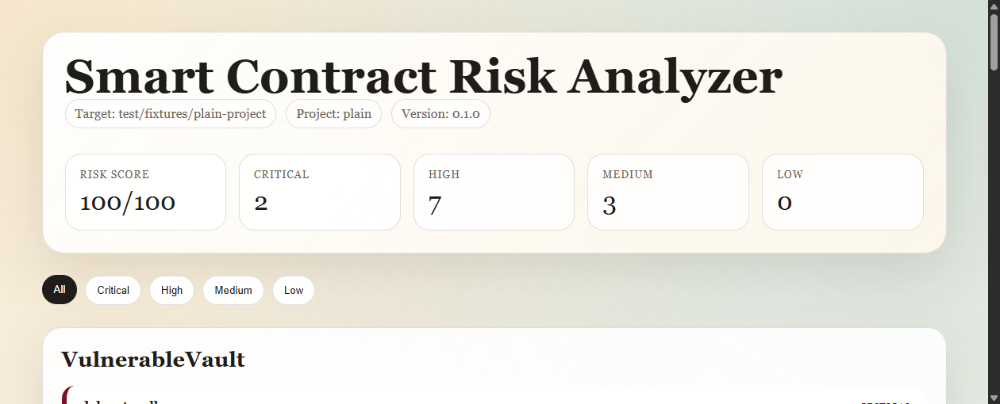

# Smart Contract Risk Analyzer (`scra`)

Flag common Solidity risk patterns before code review. `scra` runs locally on
Foundry, Hardhat, or plain Solidity projects and writes findings to the terminal,
JSON, or a standalone HTML report. It needs no account, API key, or RPC endpoint.



**Preview:** [Sample text report](docs/examples/plain-report.txt) ·
[Sample JSON](docs/examples/plain-report.json) ·
[HTML report source](docs/examples/plain-report.html). Download the HTML file
and open it in a browser to use the severity filters. The samples are from a
bundled test project, not a live deployment.

## Quick start

Use Node.js 22 or 24 and pnpm 10.28.2 (the version in `package.json`). If you
don't have pnpm, install it with `npm install --global pnpm@10.28.2`.
Build from source; an npm release is not available.

```sh
git clone https://github.com/0xmrpinheiro/smart-contract-risk-analyzer-cli.git
cd smart-contract-risk-analyzer-cli
pnpm install --frozen-lockfile
pnpm build
node dist/index.js analyze test/fixtures/plain-project/contracts/SafeVault.sol --no-color --html tmp/scra-report.html --json tmp/scra-report.json
```

Open `tmp/scra-report.html` in a browser. This example exercises both report
formats without findings at the default failure threshold. Installing
dependencies needs an internet connection; analyzing local code does not.

## Analyze your project

```sh
node dist/index.js analyze /path/to/project --html tmp/scra-report.html
node dist/index.js analyze /path/to/project --format json --no-color
node dist/index.js rules --no-color
```

Pass a `.sol` file or the project root. Install or vendor the target project's
Solidity dependencies first so imports can resolve. `--project auto` detects
Foundry and reads its remappings, detects a Hardhat project and looks for local
dependencies, or falls back to a plain Solidity layout. Override detection with
`--project foundry`, `--project hardhat`, or `--project plain`.

| Flag | Use |
| --- | --- |
| `--format text\|json` | Choose the output written to stdout (default: `text`). |
| `--json <path>` / `--html <path>` | Write a JSON or standalone HTML report. |
| `--min-severity <severity>` | Set the lowest severity included in reports (default: `low`). |
| `--fail-on <severity>` | Set the severity that makes the command return exit code `1` (default: `critical`). |
| `--no-color` | Remove ANSI styling from text output. |

Severity levels are `low`, `medium`, `high`, and `critical`. Exit code `0` means
no finding met the failure threshold; `1` means a finding met it; `2` means a
usage, import-resolution, or parse error. Reports can still be written when the
command returns `1`.

## Scope and limitations

The rules flag source patterns for human review. They can produce false
positives or miss issues. The score summarizes rule findings; it does **not**
measure exploitability or certify that a contract is safe. The CLI does not
verify deployed bytecode, perform formal verification, or replace an audit.

## Development

```sh
pnpm lint
pnpm typecheck
pnpm test
pnpm build
```

See [Contributing](CONTRIBUTING.md) for the project layout. Licensed under
[GPL-3.0-or-later](LICENSE).